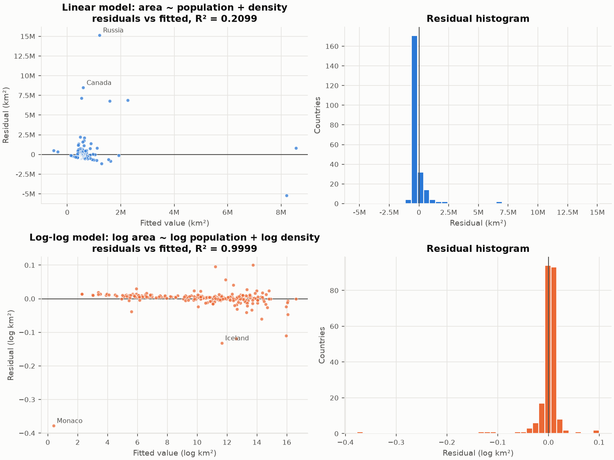
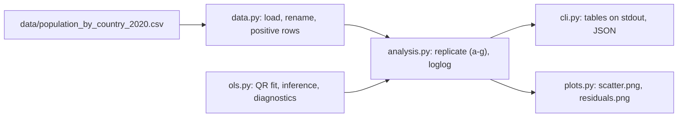
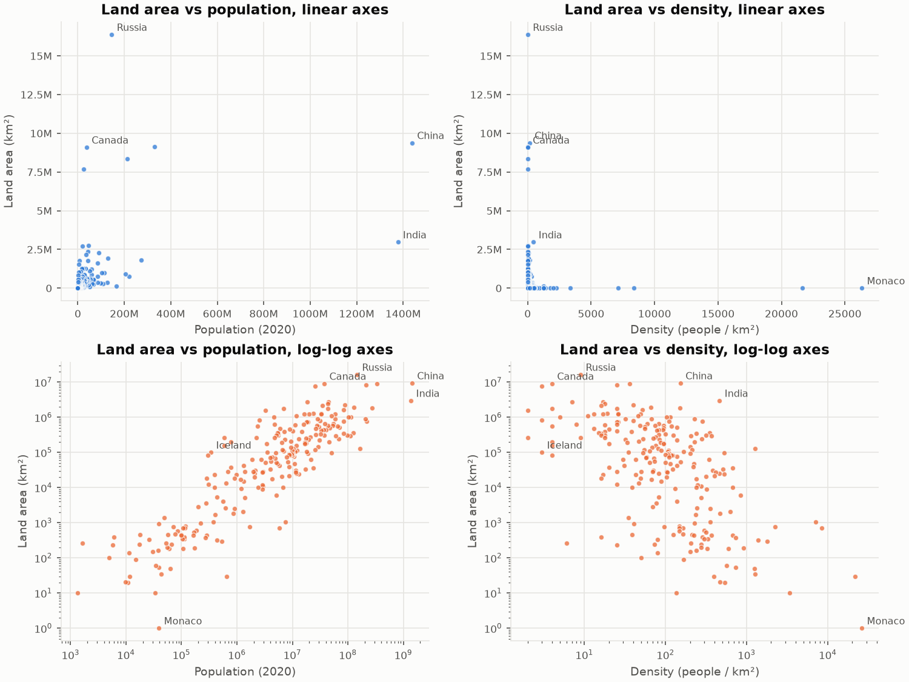

# Linear Models

Multiple linear regression from first principles (OLS via QR, t and F tests, residual diagnostics) on 2020 country data, and why the coursework model needed a log-log specification.

[](https://github.com/gcfialho/uerj-linear-models/actions/workflows/ci.yml)  [](LICENSE)



## Highlights

- **OLS without the textbook inverse.** Coefficients come from a thin QR decomposition, $R\beta = Q^\top y$, not from $(X^\top X)^{-1}X^\top y$. On this data the design matrix has condition number $1.5 \times 10^8$, so $X^\top X$ has $2.1 \times 10^{16}$. That leaves no headroom in double precision, although here both routes still agree to $2 \times 10^{-15}$.
- **Full classical inference.** Standard errors, t and F tests, confidence intervals, adjusted R², the Jarque-Bera normality test and the Breusch-Pagan heteroscedasticity test.
- **The original numbers, reproduced and checked.** A test pins every value printed in the 2023 notebook: both correlations, both R² values and the three coefficients.
- **Specification over fitting.** Population density is population divided by land area. In logs the model becomes an identity, and OLS recovers it: slopes $1.0011$ and $-1.0026$, with $R^2 = 0.9999$. The linear-scale model in the assignment explains 21% of the variance, and 5 countries account for 85% of its squared error.
- **Fixes to the coursework.** The notebook's "residual histogram" plotted the fitted values, then concluded that the errors were normal and well centred. They are not (see [Results](#results)).
- **Packaged and reproducible.** uv project, src layout, a CLI, ruff, 19 pytest tests, and GitHub Actions on Python 3.12 and 3.13.

## Quickstart

Requires [uv](https://docs.astral.sh/uv/), which installs Python 3.12 and all dependencies from `uv.lock`.

```bash
git clone https://github.com/gcfialho/uerj-linear-models.git
cd uerj-linear-models
uv sync

uv run linear-models replicate        # the assignment, items (a) to (g)
uv run linear-models loglog           # the log-log model and the identity tests
uv run linear-models all --json docs/results.json   # everything, plus docs/img/*.png
```

## How it works

Land area is the response; 2020 population and population density are the regressors.



| Module | Responsibility |
| --- | --- |
| `ols.py` | `fit()` (QR), `normal_equations()` for comparison, `pearson()`, `residual_diagnostics()`, `breusch_pagan()` |
| `data.py` | Loads the CSV and maps columns to `population`, `density`, `land_area` |
| `analysis.py` | The coursework model, the log-log model, the identity tests and the robustness fit |
| `plots.py` | Scatter plots on linear and log axes, residual plots for both models |
| `cli.py` | `linear-models replicate \| loglog \| figures \| all`, with `--data`, `--out-dir` and `--json` |

## Results

Computed with `uv run linear-models all` on Python 3.12, NumPy 2.5, SciPy 1.18 and pandas 3.1. The full output is in [`docs/results.json`](docs/results.json).

**The assignment** (235 countries, $Y$ = land area in km²):

| | ρ(Y, X) | R² (simple regression) |
| --- | ---: | ---: |
| X1 = population | +0.4557 | 0.2077 |
| X2 = density | −0.0588 | 0.0035 |

Multiple regression, $Y = \beta_0 + \beta_1 X_1 + \beta_2 X_2$:

| Term | Coefficient | Std. error | t | p |
| --- | ---: | ---: | ---: | ---: |
| Intercept | 381,688 km² | 103,309 | 3.69 | 2.7e-4 |
| Population | 0.005685 km² per person | 0.000730 | 7.79 | 2.3e-13 |
| Density | −34.19 km² per (person/km²) | 42.26 | −0.81 | 0.42 |

$R^2 = 0.2099$ (adjusted 0.2031), $F = 30.8$ ($p = 1.3 \times 10^{-12}$), residual standard error 1.51 million km². The coefficients match the 2023 notebook.

The residuals break the model's assumptions:

- **Not normal.** The skewness is 6.33 and the excess kurtosis is 52.8. Jarque-Bera rejects normality with p below double precision.
- **Not centred where the data are.** The median residual is −347,175 km², so the plane overestimates most countries.
- **Dominated by a few countries.** Russia alone contributes 43.7% of the residual sum of squares. Canada, Australia, the United States and Brazil bring the top five to 84.8%.
- **Heteroscedastic.** Breusch-Pagan gives p = 0.041.

**The log-log model** ($\log Y = \beta_0 + \beta_1 \log X_1 + \beta_2 \log X_2$). It uses 232 countries: Greenland and the Falkland Islands have a published density of 0, and the Holy See a land area of 0.

| Term | Coefficient | Std. error | Test against the identity | p |
| --- | ---: | ---: | --- | ---: |
| Intercept | −0.0051 | 0.0143 | $\beta_0 = 0$: t = −0.36 | 0.72 |
| log population | 1.0011 | 0.00079 | $\beta_1 = 1$: t = 1.44 | 0.15 |
| log density | −1.0026 | 0.00139 | $\beta_2 = -1$: t = −1.89 | 0.060 |

$R^2 = 0.99991$ and the residual standard error is 0.032 (about 3% in area). None of the three identity tests rejects at 5%.

The remaining error is rounding in the source table, which publishes density and land area as integers. Monaco shows the effect most clearly:

- Its density is published as 26,337 people/km² and its land area as 1 km².
- Population divided by density gives 1.49 km², so the published area is off by 0.40 in log units.
- That single country holds 59% of the log model's residual sum of squares.

Restricting to the 165 countries with density ≥ 10 and area ≥ 1,000 km², where rounding is small, gives slopes 1.0003 and −1.0003, with $R^2 = 0.99998$.



## Methodology

- **Least squares.** With $X$ the $n \times k$ design matrix (a column of ones, then the regressors) and $X = QR$ its thin QR decomposition, the estimate solves $R\hat\beta = Q^\top y$. The fit refuses rank-deficient designs.
- **Inference** assumes homoscedastic, independent errors:
  - the error variance is estimated by $\hat\sigma^2 = e^\top e/(n-k)$;
  - $\mathrm{Var}(\hat\beta) = \hat\sigma^2 (X^\top X)^{-1} = \hat\sigma^2 R^{-1}R^{-\top}$;
  - each $t_j = \hat\beta_j / \mathrm{se}_j$ is compared with a t distribution on $n-k$ degrees of freedom;
  - the F test compares $(\text{TSS}-\text{RSS})/(k-1)$ with $\hat\sigma^2$.
- **Correlation** is Pearson's $S_{xy}/\sqrt{S_{xx}S_{yy}}$. In a simple regression, $R^2 = \rho^2$ and the slope is $\rho\, s_y/s_x$; both are tested.
- **Diagnostics:**
  - skewness and excess kurtosis of the residuals;
  - the Jarque-Bera test;
  - Koenker's studentized Breusch-Pagan test ($nR^2$ of $e^2$ regressed on $X$, compared with $\chi^2_{k-1}$);
  - each country's share of the residual sum of squares.
- **Why log-log.** Density is defined as $X_2 = X_1 / Y$. Taking logs gives $\log Y = \log X_1 - \log X_2$, which is linear with $\beta = (0, 1, -1)$ and no error term, apart from rounding in the published figures. The linear-scale plane cannot represent a ratio, and the spread of the data across six orders of magnitude makes the largest countries dominate its fit.
- **Fixes to the original coursework (2023 notebook):**
  - Item (g) plotted a histogram of $\hat y$ instead of the residuals $y - \hat y$, and its comment ("normal and concentrated") described the wrong quantity.
  - The exported script `t2_modeloslineares.py` crashed on undefined names (`x`, `x_csv`). It also carried commented-out code for two unrelated datasets.
  - The 3-D plot used `gca(projection="3d")`, which recent Matplotlib no longer accepts.
  - Coefficients came from an explicit $(X^\top X)^{-1}$, and no standard errors or tests were reported.
  - The multiple-regression R² (0.2099) was never computed; the notebook only reported the two simple ones.

## Project structure

```
.
├── src/linear_models/      # ols, data, analysis, plots, cli
├── data/                   # population_by_country_2020.csv (see Data source)
├── docs/
│   ├── img/                # README figures (regenerate with `linear-models figures`)
│   └── results.json        # every number quoted above
├── tests/                  # pytest suite
└── .github/workflows/ci.yml
```

## Testing

```bash
uv run pytest                                        # 19 tests
uv run ruff check . && uv run ruff format --check .
```

The tests cover:

- **OLS:**
  - agreement with `numpy.linalg.lstsq` and with the normal equations;
  - recovery of known coefficients from synthetic data, with 95% intervals that cover them;
  - residuals orthogonal to every column, and TSS = ESS + RSS;
  - simple-regression closed forms: $R^2 = \rho^2$, the slope, both standard errors, and $F = t^2$;
  - exact fits, rank-deficient designs and invalid input.
- **Diagnostics:** Jarque-Bera accepts normal noise, and Breusch-Pagan flags variance that grows with $x$.
- **Analysis:**
  - every number printed by the original notebook;
  - non-normal residuals in the linear model;
  - the log-log coefficients within 0.01 of $(0, 1, -1)$, and within 0.002 in the robustness fit.
- **CLI:** an end-to-end run that writes both figures and the JSON.

## Limitations & roadmap

- The log-log fit checks a definition rather than discovering a relationship. It shows what happens when a model matches how the data were built. The coursework question, how land area relates to population and density, has no causal reading here.
- The data are one cross-section of 235 countries and dependencies, with rounded figures. Microstates and very sparse territories carry the largest relative rounding error.
- Inference is classical. Heteroscedasticity-robust (HC) standard errors and influence measures (leverage, Cook's distance) are the natural next steps; Russia and Monaco would dominate both.
- **Data source.** `data/population_by_country_2020.csv` holds Worldometer 2020 estimates, as distributed in the Kaggle dataset "Population by Country - 2020". The original notebook did not record its source, and the licence has not been verified.

Coursework (Trabalho 2) for the Linear Models course (Modelos Lineares), Computer Engineering, UERJ (Instituto Politécnico), 2023.

## Author

Guilherme Fialho · Machine Learning Engineer (GenAI/LLMs) and Data Engineer · [LinkedIn](https://www.linkedin.com/in/guilherme-cagide-fialho/) · [GitHub](https://github.com/gcfialho)

Released under the [MIT License](LICENSE).
